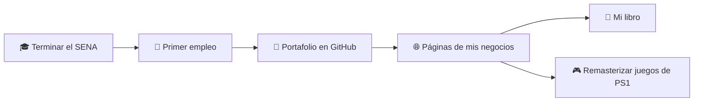

# 🎯 Mis Metas

### Del primer commit al primer empleo como desarrollador

*"Un buen desarrollador no nace, se construye commit a commit."* 🚀

---

## 📑 Contenido

- [Sobre mí](#-sobre-mí)
- [Mi ruta](#-mi-ruta)
- [Metas personales](#-metas-personales)
- [Metas académicas](#-metas-académicas)
- [Metas profesionales](#-metas-profesionales)
- [Metas a mediano plazo](#-metas-a-mediano-plazo)
- [Metas a futuro](#-metas-a-futuro)
- [Resumen](#-resumen)

---

## 👨‍💻 Sobre mí

Soy aprendiz de programación en el **SENA** y este repositorio recoge mis metas en el mundo de la tecnología: lo que quiero lograr, en qué plazo y cómo pienso llegar hasta ahí.

> 📌 Este documento es dinámico: lo iré actualizando a medida que cumpla cada meta.

---

## 🗺️ Mi ruta

---

## 🌱 Metas personales

- [ ] Aprender a crear **páginas interactivas de gran calibre**

---

## 🎓 Metas académicas

- [ ] Terminar el programa del **SENA**

---

## 💼 Metas profesionales

- [ ] Conseguir mi **primer empleo** como analista y desarrollador

---

## 📈 Metas a mediano plazo

- [ ] Subir **trabajos de calidad** a mi GitHub
- [ ] Crear APIS de utilidad comercial 

---

## 🚀 Metas a futuro

- [ ] 📖 Materializar ilustrativamente mi **libro** con lo aprendido en tecnología y programación
- [ ] 🌐 Crear las **páginas de mis negocios**
- [ ] 🎮 Remasterizar **juegos retro de PS1**

---

## 📊 Resumen

| Plazo | Meta | Estado |
|-------|------|--------|
| 🌱 Personal | Crear páginas interactivas de gran calibre | 🟡 En progreso |
| 🎓 Académica | Terminar el programa del SENA | 🟡 En progreso |
| 💼 Profesional | Conseguir mi primer empleo | ⚪ Pendiente |
| 📈 Mediano plazo | Subir trabajos de calidad a GitHub | 🟡 En progreso |
| 🚀 Futuro | Libro, negocios y juegos de PS1 | ⚪ Pendiente |

---

### 📫 Conéctate conmigo

⭐ *Si te gustó este repositorio, regálale una estrella.*

